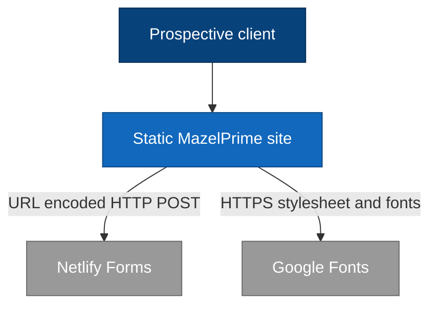
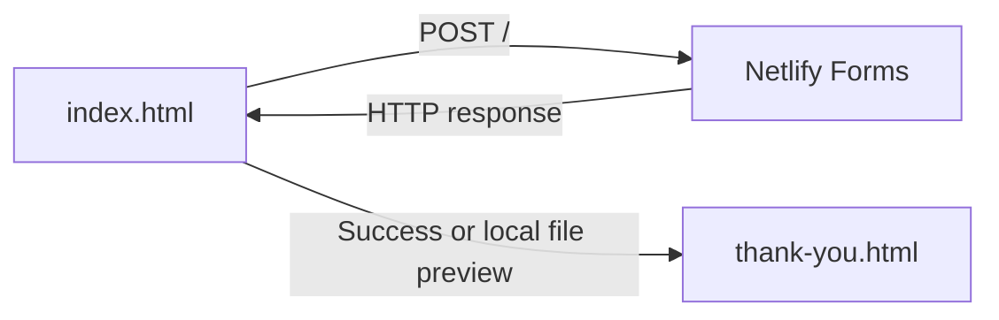
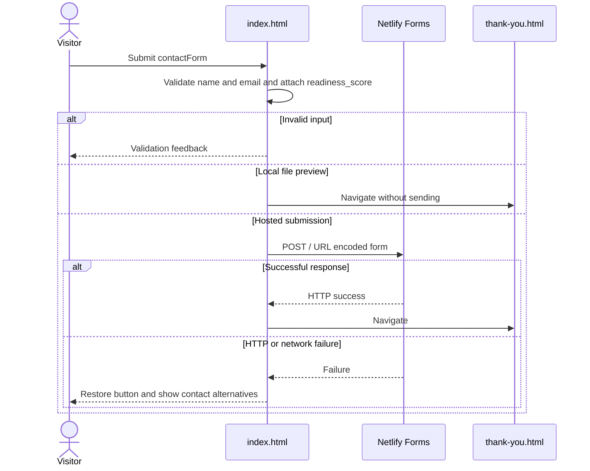

# Architecture Brief - mazelprime
> A system map, not an implementation spec. Keep it lightweight and current.
> Repository: gowthambittu/mazelprime; DevHub-Application-ID: N/A - personal project.

## Table of contents
- [System responsibilities](#system-responsibilities)
- [Primary users & use cases](#primary-users--use-cases)
- [System context](#system-context-c4-l1)
- [Major components & data flows](#major-components--data-flows-c4-l2)
- [Key flow](#key-flow-sequence)
- [Data model](#data-model-key-entities)
- [API surface](#api-surface)
- [Runtime & deployment](#runtime--deployment)
- [Quality attributes](#quality-attributes-nfrs)
- [Constraints & tradeoffs](#constraints--tradeoffs)

## System responsibilities
- Present MazelPrime services, delivery approach, and portfolio stories through index.html.
- Calculate project readiness from four browser-side sliders and include the result with discovery requests.
- Submit requests to Netlify Forms and show thank-you.html on a successful HTTP response.
- No application-owned server, database, authentication system, or scheduling integration is present.

## Primary users & use cases
| Actor | Goal / use case | Entry point |
|---|---|---|
| Prospective client | Explore services and portfolio dialogs | index.html |
| Prospective client | Assess project readiness and request a call | index.html#readiness; index.html#contact |
| Site owner | Deploy the static folder and inspect discovery submissions | README.txt; external Netlify dashboard |

## System context (C4 L1)

Visitors interact with the static site. Outbound submission is proven by contactForm and fetch('/') in index.html; the receiving Netlify service is identified by data-netlify and form-name. Both HTML pages request Google Fonts over HTTPS through link elements. No programmatic email-sending or calendar integration exists in the source.

## Major components & data flows (C4 L2)

index.html owns presentation, calculator state, and submission. Netlify owns form reception outside the repository. thank-you.html is a static destination, not a receipt-checking backend; file previews reach it without any request being sent.

### Components
| Component | Path | Responsibility | Key types |
|---|---|---|---|
| Main page | index.html | Layout, dialogs, calculator, request validation and submission | DOM nodes, score(), contactForm, FormData, URLSearchParams |
| Netlify Forms | External; contract in index.html and deployment steps in README.txt | Receive discovery submissions after form detection | form-name=discovery; bot-field |
| Confirmation page | thank-you.html | Render confirmation text and return link | Static HTML; robots noindex |

## Key flow (sequence)

The submit handler in index.html prevents the normal submission, validates inputs, attaches the current score, and disables the button while sending. A rejected or failed request leaves the visitor on the form. A successful response redirects, but receipt should still be confirmed in the Netlify dashboard.

## Data model (key entities)
No first-class persistent data model exists in this repository. There are no entities, database schemas, or migrations to support an ER diagram. Netlify manages any persisted submissions externally; its internal schema is not defined here.

| Entity | Collection / table | Key fields | Owned by |
|---|---|---|---|
| Discovery request payload, not a database entity | N/A - external form processing | form-name, readiness_score, bot-field, name, email, company, need, budget, message | DOM in index.html; received by Netlify |

## API surface
No application-owned HTTP API is implemented. The following static resources and external hosting contract are the observable web surface, not server routes authored in this repo.

| Method | Path | Purpose | Auth |
|---|---|---|---|
| GET | / or /index.html | Main static page | Public |
| POST | / | Netlify Forms discovery request; application/x-www-form-urlencoded with form-name=discovery | No application auth; Netlify configuration and honeypot apply |
| GET | /thank-you.html | Static confirmation page | Public |

## Runtime & deployment
| Aspect | Value |
|---|---|
| Runtime / version | Browser HTML/CSS and JavaScript; supported browser versions not specified |
| Build / packaging | None committed; deploy the static folder described in README.txt |
| Image / deploy unit | index.html and thank-you.html with embedded images; no container image |
| Scaling model | Hosting-managed; limits and instances not specified in repository |
| Config / secrets source | Netlify dashboard for form detection and notifications; no secret store or environment-variable configuration committed |

## Quality attributes (NFRs)
| Attribute | Notes (from code/config, else 'Not specified') |
|---|---|
| Availability / resilience | No SLA specified. Form catch handler restores retry UI and offers email/phone contact. No explicit fetch timeout or retry is implemented. |
| Throughput / latency | Not specified. Embedded base64 assets increase HTML size; Google Fonts requires external requests. |
| Security (authn/authz) | Public site, no application auth. Browser validation and Netlify honeypot are present; server-side validation guarantees are not specified here. |
| Observability | No application telemetry or logging pipeline committed; submissions are inspected externally in Netlify. |
| Failure modes | Missing Netlify form detection or another static host can break POST /. file: redirects without sending. HTTP success alone does not establish dashboard capture or email delivery. |

## Constraints & tradeoffs
- Inline styles, scripts, and embedded images simplify folder deployment but couple UI and behavior in one large file.
- Four sliders default to 3, giving 12/20. The restored implementation includes this score even if the visitor skips assessment; changing that is a separate product decision.
- Keep selector IDs and Netlify field names aligned when modifying markup or scripts.
- README.txt is the deployment source of truth. No CI, automated tests, dependency manifest, or build tooling is present.
- Email and phone links open user applications; they are not backend integrations. The one-business-day response statement in thank-you.html is UI copy, not a measured SLA.

*Last reviewed: 2026-10-29*

<!-- generated-by: poppins · do not remove (poppins-commit re-adds it) -->